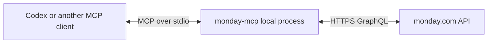
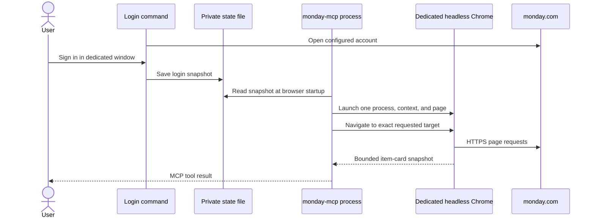
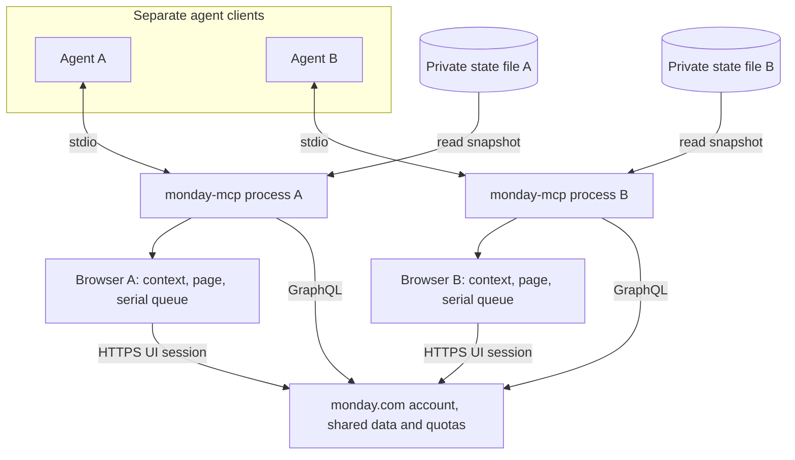

# monday-mcp architecture

monday-mcp is a local stdio MCP server. The MCP client starts a process and
exchanges tool calls over stdin/stdout. API tools send HTTPS GraphQL requests
directly to monday.com. The API token is provided to the local process through
its environment or a token file.

## Data path and value handling

The API client sends GraphQL documents to the configured monday.com endpoint
(default `https://api.monday.com/v2`) and pins the configured API version. Tool
handlers read board, group, column, item, user, workspace, and update data. List
results favor readable column text; item detail also preserves column ids,
types, and decoded stored values.

For writes, callers can identify a column by id or title and provide a plain
value. The server resolves the board column, checks the value against its type,
and serializes monday.com's expected JSON shape. For example, a status label is
translated to its board label index, a date to a date object, and people ids to
`personsAndTeams`. Unknown columns and invalid labels are reported before a
mutation is sent. An explicit object value passes through for callers who need
to provide the API shape themselves. See the README for supported mappings.

## Browser and desktop paths

The default path is the GraphQL API. With `--browser`, a process can also own a
private headless Chrome browser; `--browser-only` enables that path without an
API token. Login state is explicitly saved from a user-driven login window and
loaded from the configured state snapshot. The server does not attach to a
personal browser profile or a remote-debugging port. `--browser-executable`
can select a different browser binary; otherwise installed Chrome is used.

Each MCP process owns one browser process, context, and page. Browser operations
reuse that page while it is warm and execute serially, with at most 32
operations queued or active and per-operation deadlines. Targets must be supported
HTTPS URLs for the requested monday.com account. Navigation and evaluation
verify the target before returning a result. A separate external browser
handoff only returns a URL and instructions; monday-mcp does not control that
browser.

The browser and legacy desktop tools can open supported locations and read a
bounded item-card snapshot. They do not expose board grid cells; rendering
varies between board versions. UI posting is disabled because
composer and draft behavior can cross item boundaries. Use the API's
`monday_create_update` tool for comments.

## Policy and retry boundaries

`--read-only` exposes API read tools and rejects mutations, including raw
GraphQL mutations. Raw GraphQL is omitted when a board allow list is active,
because arbitrary documents cannot be reliably constrained to those boards.
A board allow list also disables integrated browser and desktop access: a
signed-in UI session cannot enforce that boundary. Board-scoped API tools
enforce the list, but account-level tools may still return account metadata;
this is not a tenant isolation boundary. Omit the allow-list setting for
unrestricted board scope. An empty or malformed allow list is rejected.

Reads can retry recognized transient and rate-limit failures within configured
attempt and deadline bounds. Mutations never retry automatically because a
failed response may not reveal whether monday.com applied the change. Check
current state before deciding whether to submit a mutation again.

## Multiple agents and browser isolation

Each MCP server process owns its browser session. It can read its own saved-state
file or an explicitly shared snapshot; the server never updates that snapshot.
The browser process, context, page, and operation queue remain separate. Separate
agents still act on the same monday.com account and board data, and their API
calls share the account's upstream quotas. The connector does not coordinate
agents or prevent conflicting writes. Coordinate work when agents may change
the same item.

## Verification scope

Standalone SVG exports: [API flow](diagrams/api-data-flow.svg),
[browser login](diagrams/browser-login-flow.svg), and
[multiple agents](diagrams/multi-agent-isolation.svg).

Local tests and fake API fixtures can check parsing, tool behavior, policy
enforcement, and request construction. They do not prove that a login snapshot
is accepted by a live monday.com account or establish account-specific UI
behavior. Treat live account acceptance as a separate verification step. No
performance or speed claim is implied by the local test suite.

## License and service costs

The connector is MIT-licensed and has no license fee. The license applies to
this software, not monday.com. Account eligibility, plan features, API quotas,
and any service charges are set separately by monday.com and can vary by plan
and over time. Free connector software does not mean all monday.com plans are
free or that API use is unlimited.
